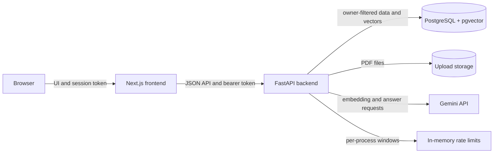

# AI Knowledge Assistant

[](https://github.com/balajipodila/ai-knowledge-assistant/actions/workflows/ci.yml)

A web app for uploading PDFs, finding relevant passages, and asking questions
with page-level citations. It uses retrieval-augmented generation (RAG): the
backend searches the user's own document chunks and gives those passages to a
language model as the only source for an answer.

## What is implemented

- Signup, login, logout, and protected pages.
- PDF upload, synchronous text extraction and chunking, document status, delete,
  and retry for embeddings that failed.
- Gemini embeddings and cosine-similarity search in PostgreSQL with pgvector.
- Cited chat with document filters, a no-match response that avoids calling the
  chat model, citation validation, and bounded retries.
- A Next.js interface for authentication, documents, and chat.
- Per-user in-process request limits for chat, upload, and search; signup/login
  attempt limits; and a per-user document cap.
- GitHub Actions checks and container image build definitions.

The project has not been deployed. The CI and Docker image jobs have not yet
been run by GitHub Actions, so those results are not verified.

## Architecture



The rate limiter is local to one backend process. It is not shared across
workers or replicas and is cleared when the process restarts.

## Technology

- Backend: Python 3.12, FastAPI, Pydantic Settings, SQLAlchemy, Alembic.
- Data: PostgreSQL, pgvector, and optional file storage (`FILE_STORAGE_BACKEND=none`, `local`, or `s3`). With `none`, the original PDF is discarded after extraction; only extracted passages and numeric embeddings remain in PostgreSQL.
- AI: Google Gemini embeddings and text generation, accessed through replaceable
  client interfaces. Automated tests use fake clients.
- Frontend: Next.js App Router, React, TypeScript, and Tailwind CSS.
- Tests and checks: pytest, Vitest, Testing Library, ESLint, TypeScript, and
  Next.js production build.
- CI and containers: GitHub Actions and digest-pinned Docker base images.

> **Privacy Note**: We do not keep your original PDF file. We store extracted text passages and numeric embeddings so we can search them, until you delete the document. Text from your documents is sent to the Google Gemini API to create embeddings and answers. Do not upload sensitive, confidential or personal documents.

The none backend requires no schema migration: migration `0003_document_ingestion`
added `documents.storage_key` as nullable, and the none backend stores `NULL`
there. This avoids a sentinel value and keeps the column semantically accurate;
the trade-off is that a document row does not identify a discarded original file.

## Run locally on Windows (without Docker)

### Prerequisites

- Python 3.12 and Node.js 22.
- PostgreSQL with the `vector` extension (or a PostgreSQL service such as Neon).
- A Gemini API key for real embedding and chat requests.

### Configure the backend

From the repository root, copy `.env.example` to `.env`. Set the database URL,
a random `JWT_SECRET_KEY` of at least 32 bytes, and the Gemini API key in your
local `.env`. Do not commit `.env` or paste its contents into logs or chat.
`TEST_DATABASE_URL` should be omitted or empty for ordinary local tests; only
use a separate disposable PostgreSQL + pgvector database for vector tests.

Create the virtual environment and install the backend:

```powershell
py -3.12 -m venv backend\.venv
.\backend\.venv\Scripts\Activate.ps1
Set-Location backend
python -m pip install -e ".[dev]"
```

Review migration SQL before applying schema changes to any database. Generate
SQL from the `backend` directory with:

```powershell
python -m alembic upgrade head --sql
```

Only apply a reviewed and approved migration. Then start the API from
`backend`:

```powershell
python -m uvicorn app.main:app --reload
```

The health endpoint is `http://localhost:8000/health`; interactive API docs
are at `http://localhost:8000/docs`.

### Configure and start the frontend

The local API URL defaults to `http://localhost:8000`. If you need a different
URL, set `NEXT_PUBLIC_API_URL` in `frontend/.env.local` (never put a secret in
this public variable).

In another PowerShell terminal:

```powershell
Set-Location frontend
npm ci --legacy-peer-deps
npm run dev
```

Open `http://localhost:3000`. Sign up or log in, upload a non-personal PDF,
wait for it to become ready, then ask a question grounded in that document.
Tokens are stored in `sessionStorage` and expire after 30 minutes. There is no
refresh token; after expiry, sign in again.

The interface uses `next/font` to bundle its sans-serif font during the build.
The first build therefore needs network access to retrieve the font; the
running site does not load the font from an external URL.

### Run tests safely

The backend tests use SQLite and fake AI clients. The PostgreSQL vector tests
skip when `TEST_DATABASE_URL` is empty. The following PowerShell values are
test-only placeholders; they do not contain real credentials:

```powershell
Set-Location backend
$env:APP_ENV = "test"
$env:DATABASE_URL = "sqlite:///./ci-only.db"
$env:TEST_DATABASE_URL = ""
$env:JWT_SECRET_KEY = "ci-only-not-a-real-secret-key-123456789"
$env:GEMINI_API_KEY = ""
python -m pytest -q
```

Run frontend checks from `frontend`:

```powershell
npm test
npm run lint
npx tsc --noEmit
npm run build
```

Do not set `TEST_DATABASE_URL` to the main database. The PostgreSQL vector
tests are optional and must use a separate disposable database with pgvector
and reviewed migrations already applied. Tests never call the real Gemini API.

## Retrieval evaluation

To measure retrieval scores, start the API and use a small UTF-8 question file
with one line per question, labelled `relevant:` or `offtopic:`. A harmless
example is in
[`backend/scripts/retrieval_questions.example.txt`](backend/scripts/retrieval_questions.example.txt).
From `backend`, run:

```powershell
python .\scripts\retrieval_scores.py --document-id <document-uuid> --questions-file .\scripts\retrieval_questions.example.txt
```

The script prompts for the test account's credentials, searches only the
selected user's selected document, and prints the top-five similarity scores
and page numbers. It never prints question text, document chunks, keys, or
tokens. It also reports the min/max top-one score for each label. The script
uses a low measurement cutoff so it can observe scores without changing the
configured search threshold.

In a user-reported, manual evaluation of 12 questions against one document on
one topic, relevant top-one scores ranged from **0.7321 to 0.7799** and
off-topic scores ranged from **0.5348 to 0.6001**. A threshold of **0.66**
separated those examples. This is a small initial measurement, not an
independent or general benchmark, and the example question file does not
reproduce that evaluation. The code's fallback default for
`SEARCH_MIN_SIMILARITY` is `0.0`; set the environment variable only after
measuring against a representative set of your own documents and questions.

## Configuration names

These are variable names only; the table contains no keys or configured values.

| Purpose | Variable names |
|---|---|
| Database | `DATABASE_URL`, `TEST_DATABASE_URL` |
| Frontend and CORS | `NEXT_PUBLIC_API_URL`, `CORS_ORIGINS` |
| Authentication | `JWT_SECRET_KEY`, `JWT_ACCESS_TOKEN_EXPIRE_MINUTES` |
| Public demo | `SIGNUP_ENABLED`, `DEMO_MODE`, `DEMO_USER_EMAIL`, `DEMO_DOCUMENT_ID`, `DEMO_SESSION_EXPIRE_MINUTES`, `DEMO_MAX_DOCUMENTS_PER_USER`, `DEMO_MAX_PDF_PAGES`, `DEMO_MAX_USERS`, `DEMO_MAX_DOCUMENTS`, `DEMO_SESSION_REQUESTS_PER_MINUTE`, `DEMO_SESSION_REQUESTS_PER_DAY`, `DEMO_CHAT_REQUESTS_PER_MINUTE`, `DEMO_CHAT_REQUESTS_PER_DAY`, `DEMO_SEARCH_REQUESTS_PER_MINUTE`, `DEMO_SEARCH_REQUESTS_PER_DAY`, `DEMO_CHAT_GLOBAL_REQUESTS_PER_DAY`, `DEMO_SEARCH_GLOBAL_REQUESTS_PER_DAY` |
| AI availability | `AI_FEATURES_ENABLED` |
| Gemini | `GEMINI_API_KEY`, `GEMINI_EMBEDDING_MODEL`, `GEMINI_EMBEDDING_DIMENSION`, `GEMINI_CHAT_MODEL`, `GEMINI_CHAT_FALLBACK_MODEL` |
| Embedding requests | `EMBEDDING_BATCH_SIZE`, `EMBEDDING_MAX_ATTEMPTS`, `EMBEDDING_BACKOFF_BASE_SECONDS`, `EMBEDDING_BACKOFF_MAX_SECONDS`, `EMBEDDING_BATCH_DELAY_SECONDS` |
| Search | `SEARCH_MAX_TOP_K`, `SEARCH_MIN_SIMILARITY` |
| Chat limits | `CHAT_MAX_OUTPUT_TOKENS`, `CHAT_GENERATION_DEADLINE_SECONDS`, `CHAT_ATTEMPT_TIMEOUT_SECONDS`, `CHAT_MAX_QUESTION_CHARS`, `CHAT_MAX_CONTEXT_CHUNKS`, `CHAT_MAX_CONTEXT_CHARS`, `CHAT_MAX_ATTEMPTS`, `CHAT_BACKOFF_BASE_SECONDS`, `CHAT_BACKOFF_MAX_SECONDS` |
| Request limits | `TRUSTED_PROXY_CIDRS`, `RATE_LIMIT_CLEANUP_INTERVAL_SECONDS`, `CHAT_REQUESTS_PER_MINUTE`, `CHAT_REQUESTS_PER_DAY`, `CHAT_CONCURRENT_REQUESTS_PER_USER`, `UPLOAD_REQUESTS_PER_MINUTE`, `UPLOAD_REQUESTS_PER_DAY`, `SEARCH_REQUESTS_PER_MINUTE`, `SEARCH_REQUESTS_PER_DAY`, `AUTH_EMAIL_ATTEMPTS_PER_MINUTE`, `AUTH_IP_ATTEMPTS_PER_MINUTE`, `MAX_DOCUMENTS_PER_USER` |
| Upload and chunking | `UPLOAD_DIRECTORY`, `MAX_UPLOAD_SIZE_BYTES`, `MAX_PDF_PAGES`, `CHUNK_SIZE`, `CHUNK_OVERLAP` |

The rate-limit settings are process-local. Forwarded client IP headers are
ignored unless the direct peer is in `TRUSTED_PROXY_CIDRS`. When
`TRUSTED_PROXY_CIDRS` is empty, the direct peer address is used, so a reverse
proxy can make the IP-only login/signup limit one shared global bucket. This
is deliberate: keep that IP-only cap generous enough for normal traffic and
use the per-email limit plus authenticated per-user resource limits as the
primary controls. Configure the proxy CIDRs only when they are known and
trusted. Keep CORS origins explicit; wildcard origins are rejected.

### Public demo protection

Set `DEMO_MODE=true` only after manually running
`backend/scripts/seed_demo.py` with a non-personal sample PDF. The landing
page's **Try demo** action creates a passwordless session for the configured
read-only demo user. Visitors can view the seeded document and use chat/search
within separate demo limits, but upload, delete, and embedding retry are
rejected by the API as well as hidden in the interface. The seeding script is
not run when a visitor starts a session.

Demo issuance does not use client IP: it uses the generous global
`DEMO_SESSION_REQUESTS_PER_MINUTE` and `DEMO_SESSION_REQUESTS_PER_DAY` caps,
so an empty `TRUSTED_PROXY_CIDRS` does not put visitors into a tight shared
issuance bucket. Each issued token has its own opaque session identity for the
per-session chat/search limits; the configurable global daily chat/search caps
remain shared across all demo sessions.

The repository includes [demo_sample.pdf](backend/scripts/demo_sample.pdf), a
one-page PDF authored for this project. It contains only the sentence “AI
Knowledge Assistant public demo sample.” and has no personal or third-party
content. The seeding script writes to the database selected by
`DATABASE_URL`—never `TEST_DATABASE_URL`—and sends the extracted sample text
to the configured Gemini embedding model once during the manual seed. It is
idempotent for the configured demo user and filename: an existing document is
left unchanged. After seeding, set `DEMO_DOCUMENT_ID` to the reported document
ID so demo chat and search are explicitly restricted to that document.

`SIGNUP_ENABLED=false` disables new account creation. Set
`AI_FEATURES_ENABLED=false` to return a friendly `503` for chat, search, and
PDF ingestion without changing authentication or document listing. This is a
Gemini-cost kill switch, not a general read-only mode.

For the production demo launch, use `SIGNUP_ENABLED=false` and
`FILE_STORAGE_BACKEND=none`. Enable signups only for a deliberate authenticated
rollout, and keep the demo user and its seeded document outside the signup
flow.

### Measuring real Neon storage

After uploading a representative sample PDF, run the following SQL in Neon,
replacing the UUID with the uploaded document's ID. It reports the actual
relation and index sizes, including `embedding_cache`, plus the sample's row
counts and logical payload sizes. Do not use an estimate based only on the
PDF's original file size: extracted text, vectors, cache rows, and indexes are
stored separately.

```sql
-- 1. Actual allocated size of the relevant tables and all their indexes.
SELECT
  c.relname AS relation,
  pg_size_pretty(pg_table_size(c.oid)) AS table_bytes,
  pg_size_pretty(pg_indexes_size(c.oid)) AS index_bytes,
  pg_size_pretty(pg_total_relation_size(c.oid)) AS total_bytes,
  pg_total_relation_size(c.oid) AS total_bytes_exact
FROM pg_class AS c
JOIN pg_namespace AS n ON n.oid = c.relnamespace
WHERE n.nspname = 'public'
  AND c.relname IN ('documents', 'chunks', 'embedding_cache')
ORDER BY total_bytes_exact DESC;

-- 2. Logical payload and cache rows for the uploaded sample document.
WITH target AS (
  SELECT id, user_id, content_hash
  FROM documents
  WHERE id = '00000000-0000-0000-0000-000000000000'::uuid
),
chunk_stats AS (
  SELECT
    count(*) AS chunk_count,
    coalesce(sum(pg_column_size(c)), 0) AS chunk_payload_bytes,
    coalesce(sum(pg_column_size(c.embedding)), 0) AS embedding_payload_bytes
  FROM chunks AS c
  JOIN target AS t ON t.id = c.document_id AND t.user_id = c.user_id
),
cache_stats AS (
  SELECT
    count(*) AS cache_row_count,
    coalesce(sum(pg_column_size(ec)), 0) AS cache_payload_bytes,
    coalesce(sum(pg_column_size(ec.embedding)), 0) AS cache_embedding_bytes
  FROM embedding_cache AS ec
  JOIN target AS t ON t.user_id = ec.user_id
  WHERE ec.content_hash = t.content_hash
)
SELECT
  t.id AS document_id,
  pg_column_size(d) AS document_row_bytes,
  cs.chunk_count,
  cs.chunk_payload_bytes,
  cs.embedding_payload_bytes,
  es.cache_row_count,
  es.cache_payload_bytes,
  es.cache_embedding_bytes
FROM target AS t
JOIN documents AS d ON d.id = t.id
CROSS JOIN chunk_stats AS cs
CROSS JOIN cache_stats AS es;
```

For a rough per-document allocation, divide each relation's `total_bytes_exact`
by its row count and multiply by the sample's row counts, then add the sample's
logical payload figures. `embedding_cache` can be shared by multiple documents
with the same content hash, so its allocated bytes are an upper bound unless
you inspect whether the cache row is reused.

## Limitations and risks

For production configuration, provider setup, manual migration/seed steps,
measurement procedures, launch checks, and rollback guidance, see the
[production runbook](docs/production-runbook.md).

- **One-process rate limits:** limits reset on restart and do not coordinate
  across multiple workers or replicas. A shared store is needed before scaling
  out.
- **Session security:** access tokens are in `sessionStorage`, which JavaScript
  can read. A future httpOnly-cookie design should also add CSRF protection.
- **No conversation history:** chat turns exist only in the current page
  session; the backend does not persist them.
- **Synchronous document work:** upload, extraction, chunking, and embedding
  happen in the request path and can take a while. A background job queue is
  not implemented.
- **Gemini availability:** provider rate limits and overload can still produce
  a friendly service-unavailable response. The optional fallback model is
  unset by default and has not been verified with a real model name.
- **Retrieval threshold evidence:** the current score separation comes from
  one small user-run evaluation. More documents and questions are needed before
  treating the threshold as generally reliable.
- **PDF support:** scanned PDFs without selectable text fail; OCR is not
  implemented.
- **Deployment:** no production deployment or real Docker image build has been
  verified. The GitHub Actions workflow must run successfully before claiming
  its image builds work. The workflow does not push images.
- **Operational polish:** no password-reset flow, persistent chat history,
  distributed rate-limit store, or backend lint/format tool is configured.

## Screenshots

Add current screenshots here after reviewing them for personal information:

- [ ] Landing and sign-in: `docs/screenshots/landing-and-login.png`
- [ ] Document upload and statuses: `docs/screenshots/documents.png`
- [ ] Answer and citations: `docs/screenshots/cited-chat.png`

## Project layout

```text
backend/                  FastAPI API, migrations, tests, and scripts
frontend/                 Next.js application and frontend tests
.github/workflows/ci.yml  CI checks and non-publishing image builds
.env.example              Configuration template (names and placeholders)
README.md                 Setup, architecture, evaluation, and limitations
```
